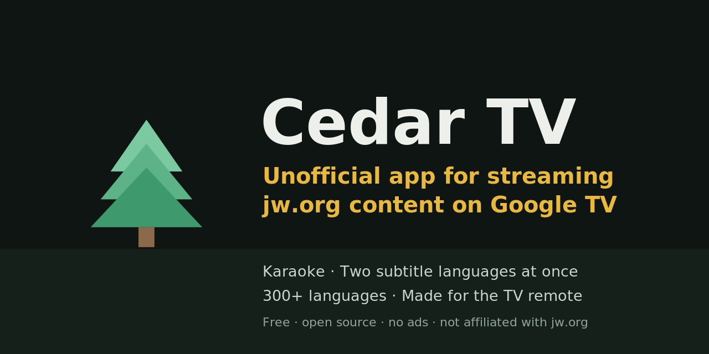
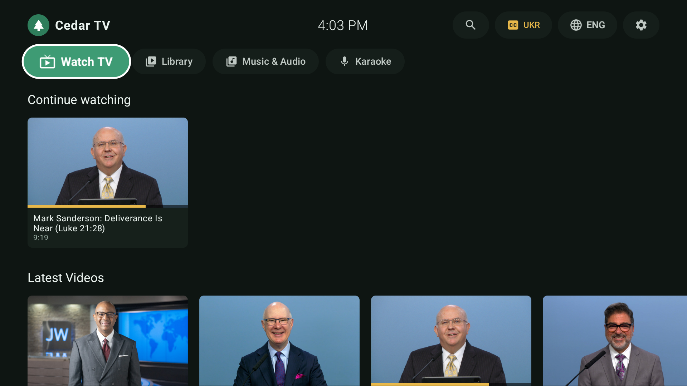
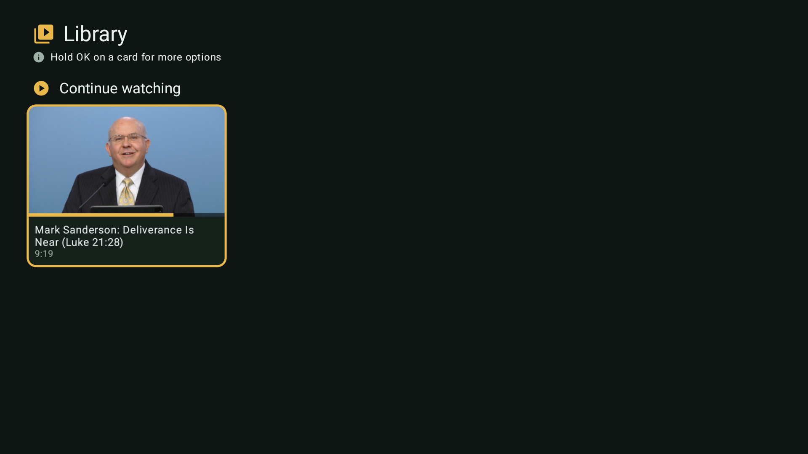
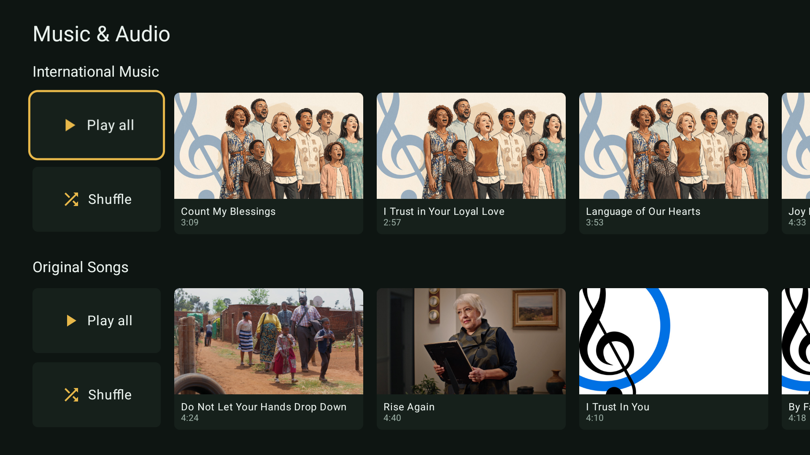
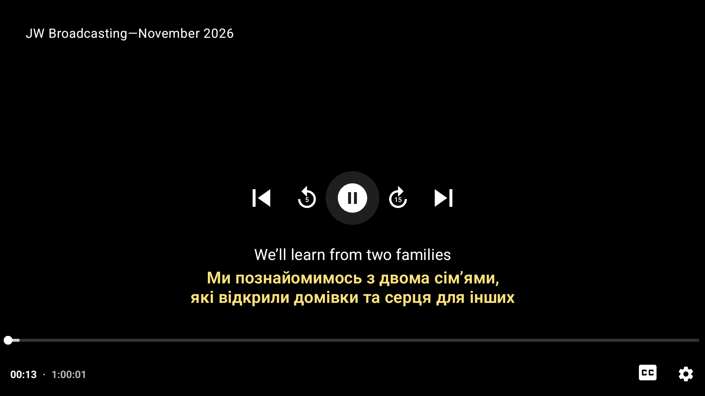
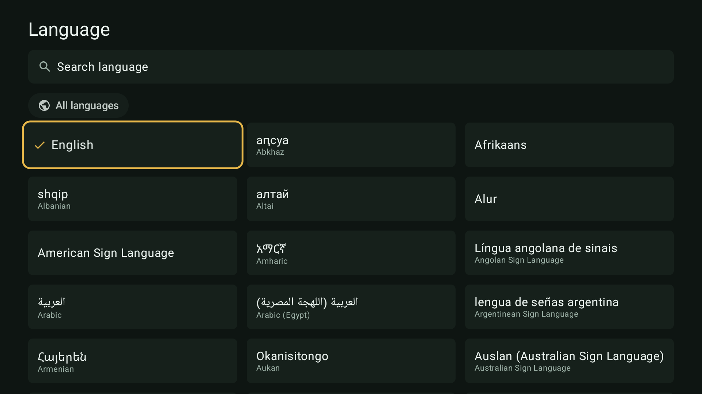
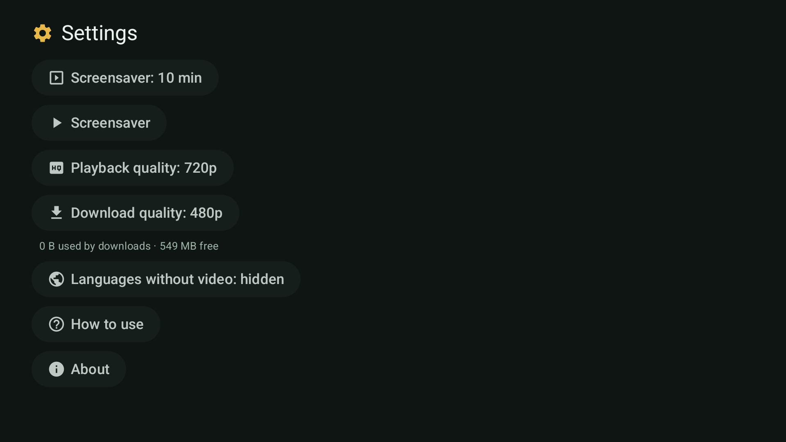

<p align="center">
  
</p>

<p align="center">
  <b>Videos, songs and sing-along in over 300 languages, made for the Google TV remote.</b><br>
  Free · open source · no ads · no account · no tracking
</p>

Cedar TV streams the free public media library of [jw.org](https://www.jw.org) (videos, JW Broadcasting, talks, songs and
audio) on your TV, with a player and interface built for the remote.

> **Unofficial.** Cedar TV is an independent hobby project. It is not affiliated with, endorsed by or sponsored by
> jw.org or any organization, and the name "Cedar TV" is not theirs. All videos, songs, texts and images belong to their
> owners and are streamed from their public servers; nothing is hosted here.

## Screenshots

<table>
  <tr>
    <td></td>
    <td></td>
  </tr>
  <tr>
    <td align="center">Home: continue watching, latest videos</td>
    <td align="center">Library: downloads, favorites, history</td>
  </tr>
  <tr>
    <td></td>
    <td></td>
  </tr>
  <tr>
    <td align="center">Music &amp; Audio: Play all / Shuffle per row</td>
    <td align="center">Player with two subtitle languages at once</td>
  </tr>
  <tr>
    <td></td>
    <td></td>
  </tr>
  <tr>
    <td align="center">312 languages, recent ones pinned</td>
    <td align="center">Settings</td>
  </tr>
</table>

## Features

- **Designed for the remote.** Everything works with the D-pad, OK, Back and Home of a Google TV Streamer remote. No hidden
  keys, no touch, no mouse.
- **Over 300 languages** for the interface content, audio and subtitles, including right-to-left languages and sign
  languages. Your recent languages are pinned to the top of every picker.
- **Two subtitle languages at once** (original + translation), with timing adjustment and a comfortable text size.
- **Smooth player** (Media3): quick scrubbing (tap = back 5 s / forward 10 s, hold to accelerate), playback speed,
  quality choice, switch audio language without leaving the video, auto-advance to the next video.
- **Music & Audio:** Play all, Shuffle, queue, sleep timer, and **Karaoke** mode with highlighted lyrics.
- **Library:** continue watching with progress bars, favorites, history, and **downloads** that play without Wi-Fi.
- **Search** with recent searches.
- **Screensaver** with artwork, a clock and the daily text; the TV never dims under a playing video.
- **Scales from 720p to 4K** with the same layout.
- **Private:** no ads, no account, no analytics. Settings, favorites and history stay on the TV.

## Install

Requirements: Google TV / Android TV (Android 8.0+, API 26).

1. Download `cedar-tv-0.1.0.apk` from the [Releases](https://github.com/chapliak/cedar-tv/releases) page.
2. Enable **Developer options** on the TV and turn on **Wireless debugging** (or use the *Downloader* app with the file link).
3. `adb connect <tv-ip>:<port>` then `adb install cedar-tv-0.1.0.apk`.

## Build from source

Needs only Docker (the build runs in the `mingc/android-build-box` image, no Android Studio).

```bash
bash build.sh                  # debug APK  -> dist/cedar-tv-debug.apk
bash build.sh assembleRelease  # optimized  -> dist/cedar-tv-release.apk (use this on the TV)
```

The build signs with `signing/cedar-test.keystore`, which is **not** in this repo. Create your own throw-away key first:
`keytool -genkeypair -keystore signing/cedar-test.keystore -alias cedartest -keyalg RSA -keysize 2048 -validity 10000 -storepass android -keypass android -dname "CN=Cedar TV test"`.

Useful tools in `tools/`: `tv-adb.sh` (adb through Docker), `bench.sh` (frame-jank benchmark), `smoke.sh` (UI smoke test).

## Tech

Kotlin · Jetpack Compose for TV (`androidx.tv`) · AndroidX Media3 (ExoPlayer) · Coil · OkHttp · kotlinx.serialization ·
a baseline profile for fast start. No Google Play Services needed.

## About

Made by [Maksym Chapliak](https://chapliak.com) in Montreal. Source: <https://github.com/chapliak/cedar-tv>.

## License

[MIT](LICENSE) for the app's code. The media, texts and images it displays are not covered by this license.
